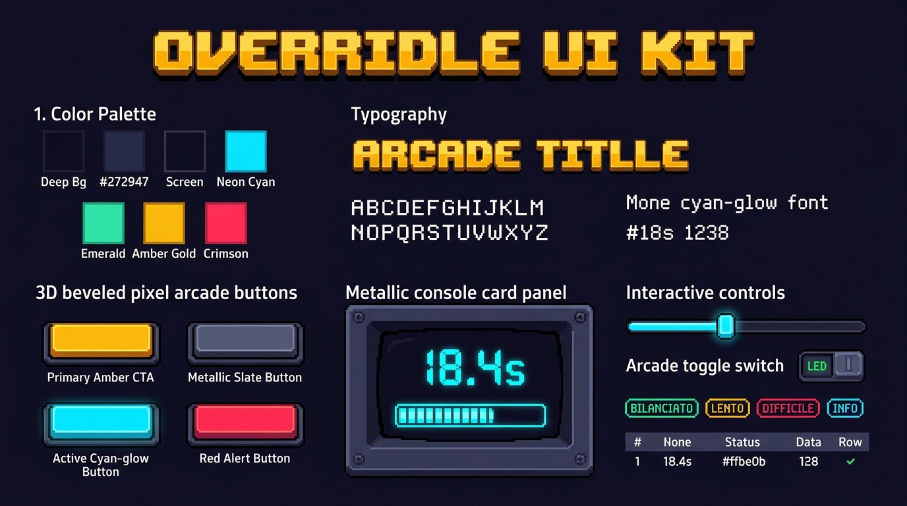

# OVERRIDLE // 16-Bit Pixel Arcade Design System

Guida completa allo stile visivo di **Overridle** (`css/pixel16.css` + `telemetry/dashboard.html`) per replicare questo look su qualsiasi sito web, dashboard o mini-app statica.



---

## 1. Font & Tipografia

Import da Google Fonts (`<head>`):

```html
<link rel="preconnect" href="https://fonts.googleapis.com">
<link rel="preconnect" href="https://fonts.gstatic.com" crossorigin>
<link href="https://fonts.googleapis.com/css2?family=Press+Start+2P&family=Silkscreen&family=VT323&display=swap" rel="stylesheet">
```

| Ruolo | Font | Dimensioni tipiche | Note d'uso |
| :--- | :--- | :--- | :--- |
| **Display / Titoli / Numeri KPI** | `'Press Start 2P', monospace` | Titolo hero: `1.45rem`–`1.95rem`<br>Titoli card: `11px`–`16px`<br>KPI / Timer: `18px`–`20px` | Molto largo: usare solo per titoli brevi, badge, numeri e bottoni CTA. |
| **UI / Testo / Tabelle / Bottoni** | `'Silkscreen', ui-monospace, monospace` | Corpo: `12px`–`14px` (`0.78rem`)<br>Label / Micro: `10px`–`11px` (`0.65rem`) | Leggibilissimo anche a `10px–12px`, perfetto per bottoni, menu e tabelle. |
| **Rendering pixelato** | — | `font-weight: 400` | Disattivare il grassetto sintetico e usare `-webkit-font-smoothing: none;` + `image-rendering: pixelated;` sulle immagini/icone. |

---

## 2. Palette Colori (CSS Custom Properties)

```css
:root {
  /* Sfondi & Superfici */
  --bg-deep: #120e24;         /* Sfondo pagina / radial gradient base */
  --bg-radial-top: #1f1a3d;   /* Alone viola-indaco in alto */
  --crt-bg: #151426;          /* Sfondo shell console */
  --px-screen-bg: #131224;    /* Schermi incassati / input / celle scure */
  --px-screen-hi: #1d1b36;

  /* Metallo / Pannelli 3D */
  --crt-panel: #272947;       /* Pannello acciaio base */
  --px-steel-hi: #8f96cc;     /* Bordo luce top-left */
  --px-steel-mid: #53598a;    /* Cornice esterna */
  --px-steel-lo: #2e3152;     /* Ombra interna bottom-right */
  --px-outline: #0d0d1a;      /* Bordo pixel netto (2px–3px solid) */

  /* Accenti Neon Arcade */
  --crt-cyan: #00e5ff;        /* Dati, stati attivi, selezioni */
  --crt-green: #2ce8a2;       /* Successo, OK, barre di caricamento */
  --crt-amber: #ffbe0b;       /* Titoli sezione, warning, target, oro */
  --crt-red: #ff2a55;         /* Errore, pericolo, allarme */

  /* Testo */
  --crt-text: #f4f6ff;        /* Bianco freddo ad alto contrasto */
  --crt-text-dim: #9aa0cf;    /* Label secondarie / sottotitoli */
}
```

---

## 3. Regole d'Oro dello Stile 16-Bit

1. **Contorni netti (`--px-outline`)**: quasi ogni card, bottone e badge ha un bordo solido `2px` o `3px` color `#0d0d1a` (`border-radius` contenuto tra `2px` e `6px`).
2. **Effetto 3D a scalino (Bevel)**: invece di ombre sfumate morbide (`blur`), si combinano:
   - Luce interna in alto a sinistra: `inset 2px 2px 0 <colore-chiaro>`
   - Ombra interna in basso a destra: `inset -2px -2px 0 <colore-scuro>`
   - Ombra solida sotto il bottone/pannello: `0 3px 0 #0d0d1a` (oppure `0 4px 0`)
3. **Effetto pressione fisica**: su `:active`, il bottone scende di `2px` (`transform: translateY(2px)`) e l'ombra inferiore si riduce a `0 1px 0 #0d0d1a`.
4. **Schermi incassati (Recessed)**: i contenitori di dati, grafici o terminali invertono la luce: sfondo `#131224` e `box-shadow: inset 2px 2px 0 #080712`.
5. **Scanlines opzionali**: overlay fisso `pointer-events: none` a `opacity: 0.14` con linee orizzontali ogni `3px–4px` per dare texture CRT senza sacrificare la leggibilità.

---

## 4. Snippet CSS Pronti all'Uso

### A. Sfondo & Scanlines

```css
body {
  margin: 0;
  background: radial-gradient(circle at 50% 0%, #1f1a3d 0%, #120e24 68%);
  color: var(--crt-text);
  font-family: 'Silkscreen', ui-monospace, monospace;
  font-weight: 400;
  -webkit-font-smoothing: none;
}

.scanlines {
  position: fixed;
  inset: 0;
  pointer-events: none;
  opacity: 0.14;
  background: repeating-linear-gradient(
    to bottom,
    rgba(255, 255, 255, 0) 0px,
    rgba(255, 255, 255, 0) 2px,
    rgba(0, 0, 0, 0.45) 3px,
    rgba(0, 0, 0, 0.45) 4px
  );
}
```

### B. Pannello Console & Schermo Incassato

```css
.px-panel {
  background: linear-gradient(180deg, #323557 0%, #232540 100%);
  border: 3px solid var(--px-outline);
  border-radius: 6px;
  padding: 14px 16px;
  box-shadow:
    inset 2px 2px 0 #62689c,
    inset -2px -2px 0 #191a30,
    0 4px 0 rgba(10, 10, 22, 0.75);
}

.px-screen {
  background: var(--px-screen-bg);
  border: 2px solid #565c8c;
  border-radius: 4px;
  padding: 10px 12px;
  box-shadow: inset 2px 2px 0 #080712;
}
```

### C. Titolo Hero & Titoli di Sezione

```css
.px-title-hero {
  font-family: 'Press Start 2P', monospace;
  font-size: clamp(1.35rem, 3vw, 1.95rem);
  color: #ffd166;
  text-shadow:
    0 3px 0 #9e5000,
    3px 3px 0 var(--px-outline),
    0 0 18px rgba(255, 190, 11, 0.45);
}

.px-title-section {
  font-family: 'Press Start 2P', monospace;
  font-size: 11px;
  color: var(--crt-amber);
  letter-spacing: 0.06em;
  text-shadow: 2px 2px 0 var(--px-outline);
}
```

### D. Bottoni Arcade 3D (Base, Primario Oro, Attivo Ciano, Pericolo Rosso)

```css
.px-btn {
  display: inline-flex;
  align-items: center;
  justify-content: center;
  gap: 8px;
  min-height: 36px;
  padding: 6px 12px;
  border: 2px solid var(--px-outline);
  border-radius: 4px;
  font-family: 'Silkscreen', monospace;
  font-size: 12px;
  letter-spacing: 0.05em;
  color: var(--crt-text);
  background: linear-gradient(180deg, #565d91 0%, #3d426b 100%);
  text-shadow: 1px 1px 0 var(--px-outline);
  box-shadow:
    inset 2px 2px 0 #8a92cc,
    inset -2px -2px 0 #2a2d4d,
    0 3px 0 var(--px-outline);
  cursor: pointer;
}

.px-btn:hover:not(:disabled) {
  background: linear-gradient(180deg, #6870ad 0%, #4a5080 100%);
}

.px-btn:active:not(:disabled) {
  transform: translateY(2px);
  box-shadow:
    inset 2px 2px 0 rgba(0, 0, 0, 0.35),
    0 1px 0 var(--px-outline);
}

/* Primario Oro / CTA */
.px-btn--primary {
  color: #241200;
  text-shadow: 0 1px 0 rgba(255, 240, 190, 0.65);
  background: linear-gradient(180deg, #ffe07d 0%, #ffb02e 55%, #e87a00 100%);
  box-shadow:
    inset 2px 2px 0 #fff3ba,
    inset -2px -2px 0 #b85d00,
    0 4px 0 var(--px-outline);
}

/* Attivo / Selezionato Ciano */
.px-btn.is-active {
  background: linear-gradient(180deg, #1b6982 0%, #0d4154 100%);
  border-color: #36e8ff;
  color: #7df4ff;
  box-shadow:
    inset 2px 2px 0 #5bf0ff,
    inset -2px -2px 0 #082936,
    0 0 10px rgba(54, 232, 255, 0.55),
    0 2px 0 var(--px-outline);
}

/* Pericolo / Allarme Rosso */
.px-btn--danger {
  color: #ffffff;
  background: linear-gradient(180deg, #ff5c82 0%, #d41542 100%);
  box-shadow:
    inset 2px 2px 0 #ffa6ba,
    inset -2px -2px 0 #8c0b29,
    0 3px 0 var(--px-outline);
}
```

### E. Badge / Tag di Stato & Progress Bar

```css
.px-tag {
  display: inline-block;
  padding: 2px 6px;
  border-radius: 3px;
  font-size: 10px;
  border: 1px solid var(--px-outline);
}

.px-tag--ok   { background: #144d38; color: var(--crt-green); border-color: var(--crt-green); }
.px-tag--warn { background: #5c4305; color: var(--crt-amber); border-color: var(--crt-amber); }
.px-tag--err  { background: #691423; color: #ff8a9b;          border-color: var(--crt-red); }
.px-tag--info { background: #1e2140; color: var(--crt-cyan);  border-color: #4f5694; }

.px-bar {
  height: 12px;
  background: #0f0e1f;
  border: 2px solid #4c5285;
  border-radius: 3px;
  overflow: hidden;
}

.px-bar-fill {
  height: 100%;
  background: linear-gradient(90deg, #00c4de, #2ce8a2);
  box-shadow: 0 0 8px rgba(44, 232, 162, 0.45);
}
```

### F. Slider 16-Bit

```css
.px-slider {
  -webkit-appearance: none;
  appearance: none;
  width: 100%;
  height: 28px;
  background: transparent;
  cursor: pointer;
}

.px-slider::-webkit-slider-runnable-track {
  height: 10px;
  background: #0a0a18;
  border: 2px solid #565c8c;
  border-radius: 3px;
}

.px-slider::-webkit-slider-thumb {
  -webkit-appearance: none;
  width: 24px;
  height: 24px;
  margin-top: -9px;
  border-radius: 3px;
  background: linear-gradient(180deg, #5cff9e 0%, #1cc964 100%);
  border: 2px solid var(--px-outline);
  box-shadow: inset 1px 1px 0 #b3ffd1, 0 0 8px rgba(56, 255, 142, 0.6);
}
```

---

## 5. Breakpoint & Dimensioni di Riferimento

- **Larghezza console centrale**: `max-width: 540px` per mini-app / mobile-first (`1180px` per dashboard desktop).
- **Spaziature compatte**: padding pannelli `8px`–`14px`, gap flex/grid `6px`–`10px`, bottoni touch-friendly `min-height: 36px` (`42px` per CTA principali).
- **Tabelle**: header su sfondo `#131224` in `--crt-amber` (`11px`), righe `padding: 8px`, separatore `1px solid #393d6b`, hover `rgba(0, 229, 255, 0.07)`.
